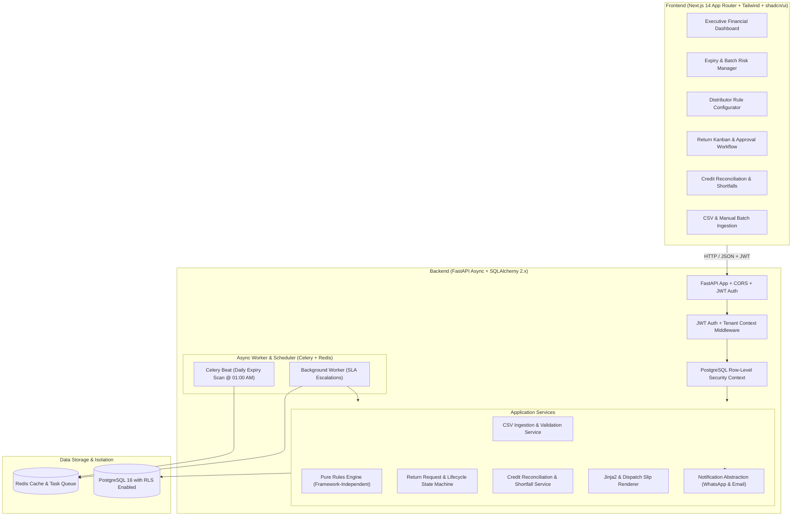

# ExpiryOS — Multi-Tenant Pharmacy Expiry Management & Return Automation SaaS

[](https://python.org)
[](https://fastapi.tiangolo.com)
[](https://nextjs.org)
[](https://www.postgresql.org)
[](https://tailwindcss.com)

**ExpiryOS** is a production-grade multi-tenant SaaS built specifically for retail pharmacies to eliminate stock write-offs, automate distributor-specific return policies, auto-generate batch return requests, and track credit note settlements.

---

## 1. System Architecture



---

## 2. Key Features

### 1. Data Ingestion & OCR Interface
- **Idempotent CSV Import**: Bulk ingest purchase entries (`item, batch_no, expiry, distributor, qty, price, invoice_no`). Re-importing identical batches updates stock without duplicates.
- **Row-Level Validation**: Invalid dates or negative quantities are flagged with row numbers and exact reasons while remaining rows are safely imported.
- **OCR / LayoutLM Interface Stub**: Clean abstract interface `InvoiceParser` designed for deep learning document extraction.

### 2. Pure Distributor Rules Engine (Core IP)
- Fully framework-independent evaluator: `evaluate(batch, distributor_rules, today)`.
- Configurable return window thresholds (e.g. 90 to 15 days before expiry).
- Multi-category exclusions (Cold Chain, Schedule X, Narcotics, Breakage).
- Multiple rule versions per distributor with effective date ranges.
- Mathematical priority scoring:
  $$\text{Priority Score} = \text{Value at Risk} \times \text{Urgency Weight} \times \text{Window Proximity Factor}$$

### 3. Expiry Monitoring & Urgency Horizons
- Daily automated scanner classifying inventory into urgency buckets:
  - **Critical (&le; 15 days)**
  - **High Risk (16–30 days)**
  - **Moderate (31–60 days)**
  - **Planned (61–90 days)**
- Proactively flags batches whose distributor return window closes within 7 days.

### 4. Return Workflow & Kanban State Machine
- Lifecycle state machine:
  $$\text{DRAFT} \rightarrow \text{APPROVED} \rightarrow \text{SENT} \rightarrow \text{ACKNOWLEDGED} \rightarrow \text{PICKED\_UP} \rightarrow \text{CREDIT\_ISSUED} \rightarrow \text{SETTLED}$$
- 1-Click Pharmacist Approval and Bulk Approval.
- Printable dispatch slips with pharmacy GSTIN declarations.
- Direct **WhatsApp Web 1-click dispatch links** (`wa.me/?text=...`) for instant communication with distributor delivery agents.

### 5. Credit Note Reconciliation & Shortfall Tracking
- Match distributor credit notes to return requests.
- Automatic shortfall calculation:
  $$\text{Shortfall} = \max(0, \text{Expected Return Value} - \text{Credited Amount})$$
- Auto-escalation of distributor credit SLA breaches.

---

## 3. Quickstart Guide

### Option A: Docker Compose (All-In-One Containerized)
```bash
# Clone the repository and run:
docker compose up --build
```
- **Web UI**: [http://localhost:3000](http://localhost:3000)
- **FastAPI OpenAPI Docs**: [http://localhost:8000/api/v1/docs](http://localhost:8000/api/v1/docs)

---

### Option B: Local Standalone Development

#### 1. Backend Setup (FastAPI)
```bash
cd backend
python -m venv venv
# On Windows:
venv\Scripts\activate
# On Linux/macOS:
source venv/bin/activate

pip install -r requirements.txt

# Run database seed script (1 tenant, 30 distributors, 1,000 SKUs, 1,500 batches)
python -m app.seeds.seed_demo_data

# Start backend dev server
uvicorn app.main:app --reload --port 8000
```

#### 2. Frontend Setup (Next.js)
```bash
cd frontend
npm install
npm run dev
```
Open [http://localhost:3000](http://localhost:3000) in your browser.

---

## 4. Demo Login Credentials

The seed script preconfigures 3 realistic roles for **Apollo Healthcare & Retail Pharmacy**:

| Role | Email | Password | Permissions |
|---|---|---|---|
| **Owner** | `owner@apollo.com` | `Password123!` | Full admin, rule editing, credit reconciliation |
| **Pharmacist** | `pharmacist@apollo.com` | `Password123!` | Batch entries, return approvals, dispatching |
| **Staff** | `staff@apollo.com` | `Password123!` | Inventory viewing and manual batch entry |

---

## 5. End-to-End Demo Walkthrough

1. **Sign In**: Navigate to `/login` and click the **Owner** preset button to log in.
2. **Review Executive KPIs**: View the **Loss Avoidance Meter** displaying avoid write-offs this month, and the urgency horizon distribution.
3. **Inspect Near-Expiry Stock**: Go to `/batches`, filter by "Window Closing (&le;7d)" or search by medicine name (e.g. `Augmentin` or `Pan D`).
4. **Auto-Draft Returns**: Click **"Scan & Auto-Draft"** on the Return Workflow board (`/returns`). The engine groups eligible near-expiry batches by distributor into draft requests.
5. **1-Click Approve**: Click **"Approve"** on a draft return or **"Approve All Drafts"** in bulk.
6. **Dispatch & WhatsApp Transmission**:
   - Transition to **"Dispatch"**.
   - Click the document icon to view the printable dispatch slip.
   - Click **"Send via WhatsApp"** to preview the pre-formatted WhatsApp text and generate a direct `wa.me` share link.
7. **Reconcile Credit Note**:
   - Go to `/credits` and click **"Record Credit Note"**.
   - Select the return request, enter the distributor credit note number, and enter the credited amount.
   - If the distributor deducted a fee, ExpiryOS flags the shortfall amount and updates the dashboard.

---

## 6. Running Tests

```bash
# Run backend pytest suite (24 tests covering Rules Engine, Ingestion, RLS, Return Lifecycle, and API)
python -m pytest backend/tests/ -v -c backend/pytest.ini

# Build frontend production bundle
cd frontend && npm run build
```
