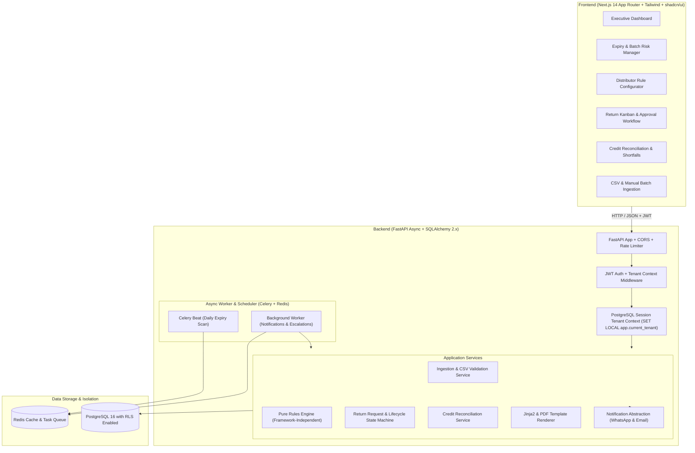
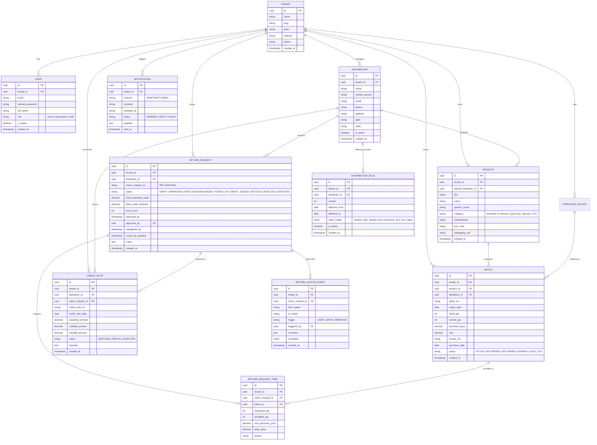

# ExpiryOS — System Architecture & Implementation Plan

ExpiryOS is a multi-tenant SaaS platform built for retail pharmacies to eliminate stock write-offs, automate distributor-specific return policies, auto-generate batch return requests, and track credit note reconciliation.

---

## 1. High-Level System Architecture



---

## 2. Monorepo Project Structure

```text
pharmacy-system/
├── backend/
│   ├── alembic/                      # Database migrations
│   │   ├── versions/
│   │   └── env.py
│   ├── app/
│   │   ├── core/                     # Core configs, security, logging
│   │   │   ├── config.py             # Pydantic v2 BaseSettings
│   │   │   ├── security.py           # Password hashing, JWT access/refresh tokens
│   │   │   ├── rls.py                # Postgres RLS session setup
│   │   │   └── rate_limit.py         # Auth rate limiting
│   │   ├── db/
│   │   │   ├── base.py               # Declarative base & tenant mixin
│   │   │   └── session.py            # Async engine and session factory
│   │   ├── models/                   # SQLAlchemy 2.0 mapped models
│   │   │   ├── tenant.py
│   │   │   ├── user.py
│   │   │   ├── distributor.py
│   │   │   ├── product.py
│   │   │   ├── batch.py
│   │   │   ├── return_request.py
│   │   │   ├── credit_note.py
│   │   │   └── notification.py
│   │   ├── schemas/                  # Pydantic v2 DTOs / Schemas
│   │   │   ├── auth.py
│   │   │   ├── distributor.py
│   │   │   ├── rule.py
│   │   │   ├── batch.py
│   │   │   ├── return_request.py
│   │   │   └── credit_note.py
│   │   ├── rules_engine/             # Pure, framework-independent rules core
│   │   │   ├── evaluator.py          # evaluate(batch, rules, today)
│   │   │   ├── types.py              # Rule schema & result dataclasses
│   │   │   └── prioritizer.py        # Urgency & value-at-risk scoring
│   │   ├── services/                 # Domain business logic
│   │   │   ├── ingestion_service.py  # CSV import, validation, idempotency
│   │   │   ├── invoice_parser.py     # OCR / LayoutLM abstract interface & stub
│   │   │   ├── return_service.py     # Lifecycle state machine & bulk approve
│   │   │   ├── credit_service.py     # Reconciliation & shortfall logic
│   │   │   ├── template_service.py   # Jinja2 text & HTML/PDF generation
│   │   │   └── notifications/        # Notification adapters
│   │   │       ├── base.py           # Provider protocol
│   │   │       ├── console.py        # Mock WhatsApp & console provider
│   │   │       ├── whatsapp_stub.py  # WhatsApp Cloud API stub
│   │   │       └── email_adapter.py  # SMTP / mock email adapter
│   │   ├── api/                      # FastAPI Routers
│   │   │   ├── v1/
│   │   │   │   ├── auth.py
│   │   │   │   ├── distributors.py
│   │   │   │   ├── batches.py
│   │   │   │   ├── ingestion.py
│   │   │   │   ├── returns.py
│   │   │   │   ├── credit_notes.py
│   │   │   │   ├── dashboard.py
│   │   │   │   └── notifications.py
│   │   │   └── router.py
│   │   ├── tasks/                    # Celery tasks
│   │   │   ├── celery_app.py
│   │   │   ├── expiry_scanner.py     # Daily job for buckets & draft returns
│   │   │   └── escalation.py         # Overdue credit SLA reminders
│   │   ├── seeds/
│   │   │   └── seed_demo_data.py     # 1 Tenant, 30 distributors, 1000 SKUs, batches
│   │   └── main.py                   # FastAPI initialization
│   ├── tests/
│   │   ├── conftest.py
│   │   ├── test_rules_engine.py      # Window boundaries, exclusions, edge cases
│   │   ├── test_rls_tenancy.py       # Cross-tenant data isolation verification
│   │   ├── test_ingestion.py         # CSV validation & idempotent imports
│   │   ├── test_return_lifecycle.py  # State machine & credit note matching
│   │   └── test_api_endpoints.py     # Endpoint integration tests
│   ├── Dockerfile
│   ├── requirements.txt
│   ├── pyproject.toml                # ruff & mypy configuration
│   └── alembic.ini
├── frontend/
│   ├── src/
│   │   ├── app/                      # Next.js 14 App Router
│   │   │   ├── layout.tsx            # Global layout with fonts & providers
│   │   │   ├── page.tsx              # Landing / Redirection
│   │   │   ├── login/page.tsx        # Modern glassmorphism auth page
│   │   │   ├── dashboard/
│   │   │   │   ├── page.tsx          # Real-time KPI metrics & financial impact
│   │   │   │   ├── batches/page.tsx  # Expiry risk table & manual entry modal
│   │   │   │   ├── import/page.tsx   # CSV purchase entry uploader & error grid
│   │   │   │   ├── returns/page.tsx  # Interactive Kanban board & bulk actions
│   │   │   │   ├── returns/[id]/page.tsx # Return request detail & printable dispatch slip
│   │   │   │   ├── distributors/page.tsx # Distributor scorecard & rules editor modal
│   │   │   │   └── credits/page.tsx  # Credit reconciliation & shortfall tracking
│   │   ├── components/               # shadcn/ui & custom UI components
│   │   │   ├── ui/                   # Button, Card, Badge, Table, Dialog, etc.
│   │   │   ├── layout/               # Sidebar, Header, TenantBadge, QuickSearch
│   │   │   ├── dashboard/            # MetricCards, RiskDonut, UrgencyTimeline
│   │   │   ├── returns/              # KanbanColumn, ReturnSlipModal, StatusBadge
│   │   │   ├── rules/                # RuleConfigDrawer, CategorySelector
│   │   │   └── import/               # DragDropZone, ValidationErrorsViewer
│   │   ├── lib/
│   │   │   ├── api.ts                # Axios/Fetch client with auto-refresh JWT
│   │   │   ├── formatters.ts         # Currency (₹/USD), dates, urgency helpers
│   │   │   └── store.ts              # UI state store
│   │   └── types/                    # Shared TypeScript interfaces
│   ├── package.json
│   ├── tailwind.config.ts
│   ├── tsconfig.json
│   └── Dockerfile
├── e2e/                              # Playwright tests
│   ├── tests/
│   │   └── happy_path.spec.ts        # Import -> View Risk -> Auto-Draft -> Approve -> Credit
│   ├── playwright.config.ts
│   └── package.json
├── docker-compose.yml                # api, worker, beat, postgres, redis, web
├── README.md                         # Architecture, quickstart, setup guide
└── .env.example
```

---

## 3. Database Schema & Multi-Tenancy Architecture

### 3.1 Multi-Tenancy via PostgreSQL Row-Level Security (RLS)
Every application table contains `tenant_id UUID NOT NULL REFERENCES tenants(id) ON DELETE CASCADE`.
For every connection in the FastAPI session dependency:
```sql
SET LOCAL app.current_tenant = :tenant_id;
```
Postgres RLS Policy:
```sql
ALTER TABLE batches ENABLE ROW LEVEL SECURITY;
CREATE POLICY tenant_isolation_policy ON batches
    FOR ALL
    USING (tenant_id = NULLIF(current_setting('app.current_tenant', true), '')::uuid);
```
*(A dedicated unit test will authenticate as Tenant A and verify that querying, updating, or deleting Tenant B’s data returns 0 records / 404).*

### 3.2 Mermaid Entity-Relationship Diagram (ERD)



---

## 4. Pure Distributor Rules Engine Specification

The rules engine is isolated in `backend/app/rules_engine/` and has zero dependencies on databases or web frameworks.

### 4.1 Configurable JSON Schema
```json
{
  "return_window_start_days_before_expiry": 90,
  "return_window_end_days_before_expiry": 15,
  "excluded_categories": ["Cold Chain", "Schedule X", "Breakage"],
  "requires_prior_authorization": false,
  "return_format": "standard_dispatch_v1",
  "pickup_days": ["Monday", "Thursday"],
  "credit_note_sla_days": 14,
  "min_return_value": 500.00
}
```

### 4.2 Evaluator Function
```python
def evaluate(batch: BatchData, rule: RuleConfig, today: date) -> EvaluationResult:
    """
    Returns:
      eligible: bool
      window_opens_on: date
      window_closes_on: date
      days_to_window_close: int
      urgency_bucket: '15d' | '30d' | '60d' | '90d' | 'expired' | 'future'
      blocked_reason: Optional[str] (e.g., 'Category Cold Chain excluded', 'Window closed 5 days ago', 'Batch quantity 0')
      priority_score: float = value_at_risk * urgency_weight * (1 / (days_left + 1))
    """
```

---

## 5. API Endpoint Specifications (FastAPI v1)

| Area | Method | Endpoint | Description |
|---|---|---|---|
| **Auth** | POST | `/api/v1/auth/login` | Login, issue JWT access + refresh tokens |
| | POST | `/api/v1/auth/refresh` | Refresh expired access token |
| | GET | `/api/v1/auth/me` | Current user details & tenant permissions |
| **Ingestion**| POST | `/api/v1/ingest/csv` | Multipart CSV upload with validation & error rows |
| | POST | `/api/v1/ingest/manual-batch` | Single batch manual entry |
| | POST | `/api/v1/ingest/invoice-parse` | Parser stub endpoint for future OCR/LayoutLM |
| **Batches** | GET | `/api/v1/batches` | List batches with expiry filter, risk score & search |
| | GET | `/api/v1/batches/risk-summary` | Aggregated count and value by urgency bucket |
| **Distributors**| GET | `/api/v1/distributors` | List distributors with scorecard metrics |
| | POST | `/api/v1/distributors` | Create distributor |
| | GET | `/api/v1/distributors/{id}/rules` | Get active and versioned rules |
| | POST | `/api/v1/distributors/{id}/rules` | Create new rule version |
| **Returns** | POST | `/api/v1/returns/auto-generate`| Group eligible batches into draft ReturnRequests |
| | GET | `/api/v1/returns` | List returns (supports Kanban status filtering) |
| | GET | `/api/v1/returns/{id}` | Return details, items, status history |
| | POST | `/api/v1/returns/{id}/transition`| Update status (e.g. DRAFT -> APPROVED -> SENT) |
| | POST | `/api/v1/returns/bulk-approve` | Bulk approve multiple draft requests |
| | GET | `/api/v1/returns/{id}/render` | Render shareable text & HTML dispatch slip |
| **Credits** | GET | `/api/v1/credits` | List credit notes and reconciliation status |
| | POST | `/api/v1/credits/reconcile` | Record credit note and calculate shortfall |
| **Dashboard**| GET | `/api/v1/dashboard/kpis` | 30/60/90d value, pending returns, overdue SLA |
| | GET | `/api/v1/dashboard/avoided-losses`| Total value saved by returns settled this month |

---

## 6. Frontend Design System & UI/UX Architecture

To fulfill the requirement for a sleek, high-end design:
- **Typography**: Inter / Plus Jakarta Sans via Next.js Google Fonts for modern readability.
- **Palette**:
  - Primary: Deep Emerald (`#059669` / `#10b981`) & Healthcare Teal (`#0d9488`) symbolizing safety, compliance, and savings.
  - Accent: Vibrant Indigo (`#6366f1`) for actions & reconciliation.
  - Dark Mode / Slate Neutrals: Zinc/Slate dark theme (`#090d16` background, `#121826` surface cards) with subtle border contrast (`border-slate-800`).
  - Semantic Risk Badges:
    - Critical (<=15d / Window Closing): Coral Red (`#ef4444`, soft translucent fill)
    - High Risk (16-30d): Amber Orange (`#f59e0b`)
    - Moderate (31-60d): Honey Yellow (`#eab308`)
    - Planned (61-90d): Slate / Cyan (`#06b6d4`)
- **Micro-Interactions & Glassmorphism**:
  - Subtle frosted glass header and metric stat cards.
  - Kanban board with drag-and-drop or single-click transition modals.
  - Copyable WhatsApp share summary with one-click clipboard toast.
  - Interactive shortfall alerts highlighting distributor discrepancies.

---

## 7. Milestone Breakdown & Delivery Plan

### Milestone 1: Core Foundation & Rules Engine
- Monorepo setup with FastAPI backend and Next.js frontend structure.
- Database models (SQLAlchemy 2.x), Alembic migration setup, PostgreSQL RLS policies.
- Pure distributor rules engine with 100% test coverage on edge cases (boundaries, exclusions, priority score).
- Verification: Pytest suite for rules engine & RLS isolation passing.

### Milestone 2: Data Ingestion & Expiry Scanner
- CSV parser with row-level error reporting, validation (dates, quantities), and idempotent re-import.
- `InvoiceParser` interface stub for future OCR/LayoutLM.
- Batch and product service layers.
- Celery task: daily expiry scanner, urgency bucket calculator, return eligibility evaluator.
- Verification: Tests for CSV ingestion and scanner job execution.

### Milestone 3: Return Lifecycle, Dispatch Slips & Notifications
- Return request grouping by distributor.
- Return state machine (`DRAFT` through `SETTLED`) with `ReturnStatusEvent` audit trail.
- Jinja2 template rendering for distributor dispatch slips and shareable text.
- Notification abstraction: Console/Mock WhatsApp provider and Email adapter.
- Bulk approve functionality.
- Verification: Lifecycle transition unit tests and dispatch slip generation tests.

### Milestone 4: Credit Note Reconciliation & SLA Escalations
- Credit note creation and reconciliation engine (expected vs. actual, shortfall calculation).
- Distributor SLA tracking and overdue escalation job.
- Seed script generating 1 tenant, 30 distributors with diverse rules, 1000 SKUs, realistic batch distributions.
- Verification: Credit shortfall tests and seed script verification.

### Milestone 5: Executive Dashboard & Frontend Workflows
- Next.js 14 frontend setup with Tailwind CSS, Lucide icons, and modern design system.
- Executive KPI dashboard (value at risk, avoided write-offs, pending credits).
- Batch risk manager with filters and manual batch entry.
- CSV upload interface with live validation error reporting.
- Kanban return workflow with single-click approvals and printable dispatch slips.
- Distributor scorecard and interactive rules editor.
- Credit reconciliation panel.

### Milestone 6: Docker Compose, E2E Testing & Polish
- Docker Compose configuration (`api`, `worker`, `beat`, `postgres`, `redis`, `web`).
- Playwright E2E happy path test (import CSV -> see risks -> auto-draft -> approve -> reconcile credit).
- OpenAPI documentation verification and comprehensive README with Mermaid diagrams.
- Demo walkthrough guide.

---

## 8. Assumptions & Decisions
1. **Multi-Tenancy Local Dev**: For local testing without a live PostgreSQL cluster, an async SQLite fallback can be used for unit tests of pure logic and service layers, while PostgreSQL RLS migration scripts and dedicated Postgres tests remain fully intact.
2. **Notification Channel**: The default notification provider is configured as `ConsoleWhatsAppProvider` which prints cleanly formatted WhatsApp messages with one-click share links in the UI, keeping the real Meta WhatsApp Cloud API adapter as a production-ready stub.
3. **Template Rendering**: Dispatch slips will be rendered in Jinja2 HTML with print-ready CSS (convertible to PDF via browser print / WeasyPrint).
